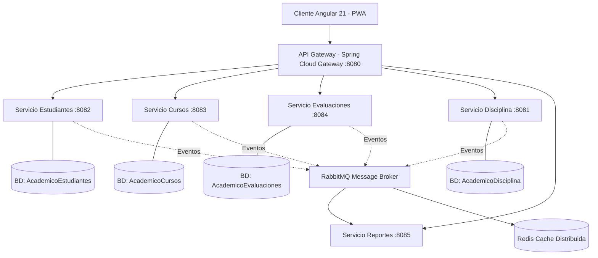
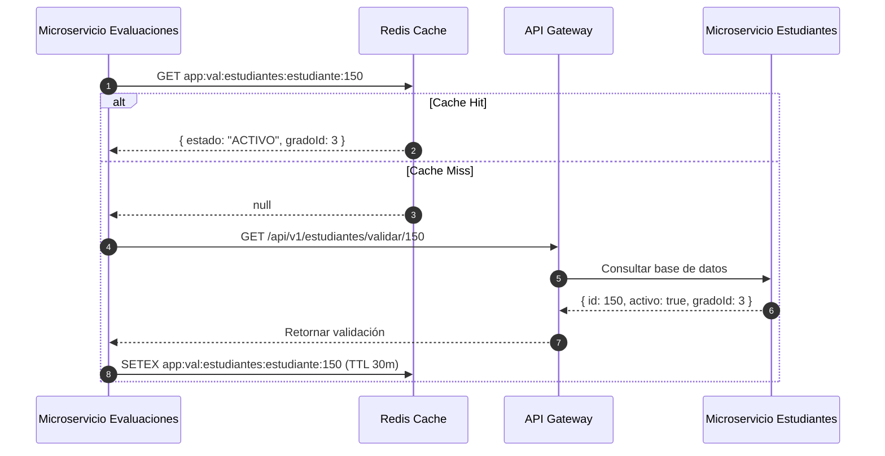

# Pautas y Especificaciones Maestras para el Desarrollo del Sistema
## Plataforma Académica Distribuida (PAD)

Este documento consolida las directrices de ingeniería, arquitectura de microservicios, diseño de interfaz, control de calidad y flujos de negocio para guiar el desarrollo continuo del sistema.

---

## 1. Principios de Conducta y Habilidades del Asistente

### 1.1 Diseño Visual y Frontend
- **Animaciones y Micro-interacciones (Estilo Emil Kowalski):** Priorizar transiciones fluidas, respuestas visuales inmediatas y retroalimentación de estado no intrusiva.
- **Tipografía y Espaciado:** Estructura visual basada en tipografías modernas (`Inter`, `JetBrains Mono`), jerarquía clara de encabezados y márgenes armónicos.
- **Glassmorphism & Dark Mode:** Fondos translúcidos con `backdrop-filter: blur`, bordes tenues y contrastes equilibrados.
- **Iconografía Exclusiva:** Prohibido el uso de emojis en la interfaz. Utilizar únicamente iconos vectoriales de Bootstrap (`bootstrap-icons`).

### 1.2 Calidad y Pruebas
- **Testing Automatizado (Playwright):** Creación y ejecución de pruebas E2E, simulación de cortes de red (modo offline) y pruebas de eventos de teclado.
- **Memoria de Errores (`napkin.md`):** Registro continuo de fallos detectados y soluciones implementadas para evitar regresiones.

### 1.3 Comunicación y Eficiencia
- **Concisión y Claridad:** Respuestas técnicas directas, estructuradas y orientadas a la acción.
- **Optimización de Recursos:** Respuestas de alto valor técnico sin redundancia de texto.

---

## 2. Arquitectura del Sistema y Tecnologías

El sistema se compone de microservicios independientes que garantizan alta disponibilidad, desacoplamiento y escalabilidad:



### 2.1 Stack Tecnológico
- **Backend:** Java 17 + Spring Boot 3.x (Spring Data JPA, Spring Cloud Gateway, Resilience4j, Spring Security, Lombok, MapStruct).
- **Base de Datos:** Microsoft SQL Server 2022 (Patrón *Database-per-Service*).
- **Caché Distribuida:** Redis (Patrón *Cache-Aside* con invalidación reactiva).
- **Broker de Mensajería:** RabbitMQ (Topic Exchange con soporte DLQ).
- **Frontend:** Angular 21 (SPA + PWA, Bootstrap 5 utilidades, TypeScript).
- **Infraestructura:** Docker & Docker Compose.
- **Testing E2E:** Playwright.

---

## 3. Estrategia de Datos y Soft Foreign Keys

Al seguir el patrón *Database-per-Service*, las referencias entre microservicios no utilizan restricciones `FOREIGN KEY` físicas a nivel SQL. Se manejan como **Soft Foreign Keys (Claves Foráneas Lógicas)** de tipo `BIGINT`.

### 3.1 Matriz de Conexiones Lógicas

| Microservicio Origen | Tabla / Campo | Microservicio Destino | Validación |
|---|---|---|---|
| `servicio-estudiantes` | `estudiantes.grado_id` | `servicio-cursos` (`grados.id`) | Redis Cache / REST fallback |
| `servicio-estudiantes` | `estudiantes.seccion_id` | `servicio-cursos` (`secciones.id`) | Redis Cache / REST fallback |
| `servicio-evaluaciones` | `notas.estudiante_id` | `servicio-estudiantes` (`estudiantes.id`) | Redis Cache / REST fallback |
| `servicio-evaluaciones` | `notas.curso_id` | `servicio-cursos` (`cursos.id`) | Redis Cache / REST fallback |
| `servicio-evaluaciones` | `notas.docente_id` | `servicio-cursos` (`docentes.id`) | Redis Cache / REST fallback |
| `servicio-evaluaciones` | `asistencias.horario_id` | `servicio-cursos` (`horarios.id`) | Redis Cache / REST fallback |
| `servicio-disciplina` | `reportes_disciplinarios.estudiante_id` | `servicio-estudiantes` (`estudiantes.id`) | Redis Cache / REST fallback |

---

## 4. Caché Distribuida con Redis (Patrón Cache-Aside)

Para evitar saturar la red con consultas HTTP inter-servicio durante el ingreso masivo de notas o asistencias, se implementa una capa de caché en Redis.

### 4.1 Clasificación y TTL de Datos

```text
Estructura de Claves: app:val:{modulo}:{entidad}:{id}
```

| Nivel de Variabilidad | Entidades | Clave Redis Ejemplo | TTL | Estrategia de Sincronización |
|---|---|---|---|---|
| **Baja Variabilidad** (Estática) | Niveles, Grados, Secciones, Cursos | `app:val:cursos:seccion:12` | 12 a 24 horas | Invalidación por evento de modificación |
| **Media Variabilidad** (Dinámica) | Estado de Estudiante, Carga Docente | `app:val:estudiantes:estudiante:150` | 15 a 30 minutos | Invalidación inmediata ante traslados o bajas |

### 4.2 Flujo de Validación de Claves



---

## 5. Arquitectura de Mensajería Asíncrona con RabbitMQ

Para procesar tareas no bloqueantes (alertas a apoderados por WhatsApp/SMS, predicción de deserción por IA y sincronización de caché), se utiliza un **Topic Exchange**.

### 5.1 Topología del Broker

- **Exchange Principal:** `academic.exchange.topic` (Type: Topic, Durable: true).
- **Mecanismos de Resiliencia:** `deliveryMode = 2` (mensajes persistentes) y Dead Letter Queues (DLQ) para reintentos fallidos.

| Cola | Routing Key Pattern | Consumidor | Propósito |
|---|---|---|---|
| `q.notificaciones.comunicaciones` | `notificacion.apoderado.*` | `servicio-reportes` | Envío de WhatsApp/SMS a tutores |
| `q.ia.desercion-predictor` | `disciplina.reporte.*`, `evaluacion.nota.*`, `evaluacion.asistencia.*` | `servicio-reportes` (Módulo IA) | Cálculo de riesgo preventivo de deserción |
| `q.val.cache-invalidator` | `val.entity.changed.*` | Todos los servicios | Desalojo reactivo de claves en Redis |
| `q.cursos.congelamiento-eventos` | `cursos.calendario.congelado` | `servicio-evaluaciones`, `servicio-estudiantes` | Ajuste masivo por festividades o clima |

---

## 6. Flujos de Negocio Críticos

### Flujo 1: Matrícula, Control de Vacantes y Legajos Digitales
1. **Validación de Aforo:** Secretaría solicita matricular alumno en una sección.
2. **Cálculo:** Se valida que los alumnos activos en `estudiantes` para dicha sección no superen la `capacidad_maxima` definida en `AcademicoCursos.secciones`.
3. **Carga Documental:** El legajo (DNI, partida de nacimiento, resolución SIAGIE) se persiste como binario `VARBINARY(MAX)` en `documentos_adjuntos`.

### Flujo 2: Reprogramación y Congelamiento Regional (Huamanga)
1. **Suspensión en Bloque:** Ante festividades (Semana Santa) o emergencias climáticas, la Dirección cambia el estado en `periodos_escolares` a `SUSPENDIDO`.
2. **Propagación:** Se emite el evento `cursos.calendario.congelado` a RabbitMQ.
3. **Efecto:** El microservicio de evaluaciones pausa los calendarios de cierre de notas y suprime la generación automática de faltas para el periodo afectado.

### Flujo 3: Evaluación por Competencias MINEDU y Auditoría
1. **Normativa Curricular:** Registro de calificaciones bajo la escala literal oficial (`AD`, `A`, `B`, `C`) con equivalencia vigesimal referencial (`0 - 20`).
2. **Trazabilidad Inmutable:** Cada modificación de nota almacena fecha/hora, usuario responsable, valor anterior y nuevo valor (Hibernate Envers / Logs).

### Flujo 4: Convivencia Escolar y Prevención de Deserción
1. **Papeleta Digital:** El docente emite una incidencia en `reportes_disciplinarios`.
2. **Alerta Automática:** El evento viaja a RabbitMQ; el módulo de comunicaciones consulta el teléfono del tutor en `apoderados` y notifica vía WhatsApp/SMS.
3. **Score IA:** El modelo predictivo ajusta el índice de vulnerabilidad del estudiante considerando notas, inasistencias y factores de contexto regional.

---

## 7. Experiencia de Usuario y Portal Docente (PWA)

- **Digitación de Alto Rendimiento:** Cuadrícula tipo hoja de cálculo con scroll virtual para grupos numerosos (>35 alumnos).
- **Ciclado Rápido de Teclado:** Presionar consecutivamente teclas de acceso rápido (ej. tecla `A` cicla entre `A` y `AD`, tecla `C` asigna `C`).
- **Arquitectura Offline-First:**
  - Almacenamiento local temporal en `IndexedDB` ante pérdidas de señal en aulas.
  - Indicador visual de estado de sincronización.
  - Vaciado automático de la cola local contra el backend al restaurar conexión.

---

## 8. Plan de Pruebas Automatizadas (Playwright)

Toda nueva funcionalidad debe validarse mediante pruebas E2E bajo los siguientes escenarios clave:

1. **Prueba de Ciclado de Notas:** Verificar que la digitación rápida por teclado actualice las escalas literales sin latencia.
2. **Prueba de Resiliencia Fuera de Línea (Offline):** Simular desconexión de red, validar almacenamiento en IndexedDB y comprobar sincronización automática al reconectar.
3. **Prueba de Control de Acceso (RBAC):** Verificar que los roles de usuario restrinjan el acceso a módulos no autorizados (ej. Docente sin acceso a Fichas Médicas de Tópico).

---

## 9. Próximos Pasos de Implementación

1. **Infraestructura:** Despliegue de contenedores Docker para RabbitMQ y Redis junto a SQL Server 2022.
2. **Lógica de Backend:** Implementación de listeners AMQP para invalidación de caché y clientes WebClient protegidos con Resilience4j.
3. **Componentes PWA:** Construcción de la cuadrícula de notas en Angular con atajos de teclado y soporte IndexedDB.
