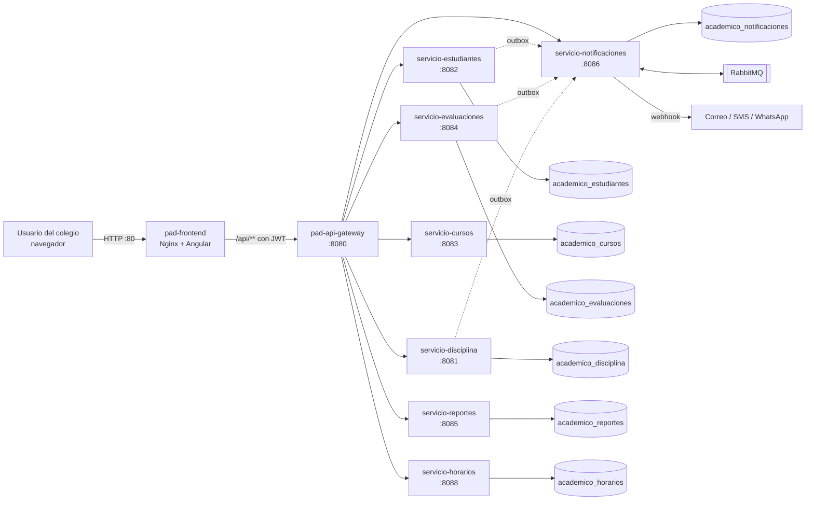
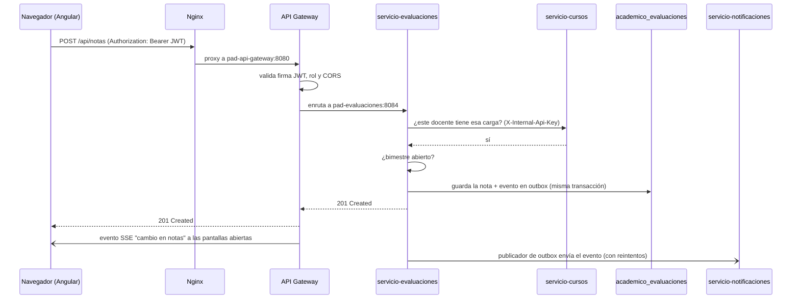
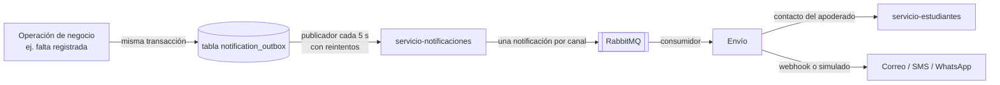

# Plataforma Académica Distribuida

Sistema de gestión académica para un colegio público de secundaria, construido como un
**sistema distribuido de microservicios** que corre completo en **Docker**.

Cubre la vida diaria del colegio: matrícula y nóminas, cursos, secciones y horarios, notas por
competencias y cierre de bimestres, asistencia e ingreso con DNI, convivencia escolar e
incidencias, permisos y papeletas, tópico y fichas de salud, derivaciones a psicología, tickets
de mantenimiento, portal del apoderado, notificaciones a las familias, reportes, alertas de
deserción y auditoría.

| Capa | Tecnología |
|---|---|
| Frontend | Angular 21 (TypeScript 5.9), servido por Nginx |
| Puerta de entrada | Spring Cloud Gateway (Spring Boot 3.4) con JWT, CORS, circuit breaker y tiempo real (SSE) |
| Microservicios | 7 servicios Spring Boot 3.4 (Java), cada uno con su propia base de datos |
| Datos | PostgreSQL 15, una base por servicio, migraciones versionadas con Flyway |
| Mensajería | RabbitMQ 4 (cola de notificaciones) + patrón *outbox* transaccional |
| Horarios | Motor de optimización Timefold |
| Operación (opcional) | Prometheus, Grafana, Zipkin, respaldos cifrados, pgAdmin |

---

## Índice

1. [Cómo funciona (vista general)](#1-cómo-funciona-vista-general)
2. [Qué contiene el repositorio](#2-qué-contiene-el-repositorio)
3. [Los componentes y cómo se conectan](#3-los-componentes-y-cómo-se-conectan)
4. [Recorrido de una petición](#4-recorrido-de-una-petición)
5. [Comunicación entre servicios](#5-comunicación-entre-servicios)
6. [Roles y seguridad](#6-roles-y-seguridad)
7. [Módulos funcionales](#7-módulos-funcionales)
8. [Puesta en marcha con Docker](#8-puesta-en-marcha-con-docker)
9. [Configuración (.env)](#9-configuración-env)
10. [Perfiles opcionales de operación](#10-perfiles-opcionales-de-operación)
11. [Pruebas](#11-pruebas)
12. [Comandos útiles y solución de problemas](#12-comandos-útiles-y-solución-de-problemas)
13. [Documentación adicional](#13-documentación-adicional)

---

## 1. Cómo funciona (vista general)



En pocas palabras:

1. El usuario abre el sistema en el navegador. **Nginx** entrega la aplicación Angular.
2. La aplicación hace todas sus llamadas a `/api/...`. Nginx las reenvía al **API Gateway**;
   no existe ningún camino para llegar a un microservicio sin pasar por el gateway.
3. El gateway **valida el token JWT y los roles**, y enruta según el prefijo de la URL al
   microservicio correspondiente.
4. Cada microservicio vuelve a comprobar los permisos, aplica sus reglas de negocio y usa
   **solo su propia base de datos**.
5. Cuando un servicio necesita datos de otro, lo llama por HTTP interno con una clave de
   servicio (`X-Internal-Api-Key`), nunca leyendo la base del otro.
6. Los avisos a las familias se guardan primero en una tabla *outbox* dentro de la misma
   transacción de la operación, y luego se entregan a **Notificaciones**, que los encola en
   **RabbitMQ** y los envía por los canales configurados.
7. Cada escritura exitosa genera un evento que el gateway difunde por **Server-Sent Events**,
   así las pantallas abiertas se actualizan en tiempo real.

---

## 2. Qué contiene el repositorio

```
sistemaDistribuido/
├── docker-compose.yml          # Orquesta todos los contenedores (servicios, BD, cola, frontend)
├── .env.example                # Plantilla de configuración (copiar como .env)
├── README.md                   # Este documento
│
├── backend/
│   ├── init-postgres-dbs.sh    # Crea las 7 bases de datos al iniciar PostgreSQL por primera vez
│   ├── api-gateway/            # Spring Cloud Gateway: rutas, JWT, CORS, fallback, tiempo real
│   ├── servicio-estudiantes/   # Login, usuarios, estudiantes, matrícula, apoderados, salud, permisos…
│   ├── servicio-cursos/        # Niveles, grados, secciones, cursos, docentes, carga, aulas, tickets
│   ├── servicio-evaluaciones/  # Notas, asistencia, bimestres y su cierre auditado
│   ├── servicio-disciplina/    # Incidencias y protocolo de violencia escolar (SíseVe)
│   ├── servicio-reportes/      # Estadísticas, alertas de deserción, actividad, integridad
│   ├── servicio-notificaciones/# Avisos a apoderados (RabbitMQ + proveedores)
│   └── servicio-horarios/      # Generación automática de horarios con Timefold
│
├── frontend/                   # Aplicación Angular 21
│   ├── src/app/core/           # Autenticación, guards, interceptores, tiempo real
│   ├── src/app/layout/         # Menú, cabecera y estructura general
│   ├── src/app/pages/          # Una carpeta por pantalla (matrícula, notas, asistencia…)
│   ├── src/app/services/       # Clientes HTTP hacia /api
│   ├── src/app/shared/         # Componentes reutilizables
│   ├── tests/                  # Pruebas E2E con Playwright
│   ├── nginx.conf              # Servidor web y proxy /api → gateway
│   └── Dockerfile              # Compila Angular y lo publica en Nginx
│
├── ops/                        # Operación
│   ├── backup/                 # Respaldo cifrado AES-256 + prueba de restauración
│   ├── demo/                   # Datos de demostración (secundaria 2026)
│   ├── docker/                 # Dockerfiles alternativos con artefactos precompilados
│   ├── observability/          # Prometheus y paneles de Grafana
│   └── tests/                  # Pruebas de humo, contrato del gateway, resiliencia, carga
│
├── documentacion/              # Flujos, matriz de roles, pruebas, auditorías, políticas
└── modulos_pad/                # Idea original del proyecto
```

Cada microservicio sigue la misma estructura interna de Spring Boot:

```
servicio-x/
├── Dockerfile                  # Compilación Maven multi-etapa → imagen JRE liviana
├── pom.xml
└── src/main/
    ├── java/com/example/...
    │   ├── controller/         # Endpoints REST (/api/...)
    │   ├── service/            # Reglas de negocio y clientes hacia otros servicios
    │   ├── model/ o entity/    # Entidades JPA
    │   ├── repository/         # Acceso a datos (Spring Data JPA)
    │   ├── dto/                # Objetos de entrada/salida
    │   ├── config/             # Seguridad, JWT, inicialización
    │   └── exception/          # Manejo global de errores
    └── resources/
        ├── application.properties
        └── db/migration/       # Migraciones Flyway V1__…, V2__…
```

---

## 3. Los componentes y cómo se conectan

### Contenedores

| Contenedor | Servicio | Puerto | Publicado en el host | Base de datos |
|---|---|---:|---|---|
| `pad-frontend` | Nginx + Angular | 80 | `0.0.0.0:80` (acceso desde la red) | — |
| `pad-api-gateway` | API Gateway | 8080 | `127.0.0.1:8080` (solo esta PC) | — |
| `pad-estudiantes` | Estudiantes y autenticación | 8082 | no | `academico_estudiantes` |
| `pad-cursos` | Cursos y estructura académica | 8083 | no | `academico_cursos` |
| `pad-evaluaciones` | Notas y asistencia | 8084 | no | `academico_evaluaciones` |
| `pad-disciplina` | Convivencia | 8081 | no | `academico_disciplina` |
| `pad-reportes` | Reportes e integridad | 8085 | no | `academico_reportes` |
| `pad-notificaciones` | Notificaciones | 8086 | no | `academico_notificaciones` |
| `pad-horarios` | Motor de horarios | 8088 | no | `academico_horarios` |
| `pad-postgres` | PostgreSQL 15 | 5432 | `127.0.0.1:5433` | las 7 anteriores |
| `pad-rabbitmq` | RabbitMQ 4 + consola | 5672 / 15672 | `127.0.0.1` | — |

Todos los contenedores comparten la red interna `pad-network` y se encuentran por nombre
(por ejemplo `http://pad-cursos:8083`). Los microservicios **no** exponen puertos al host: solo
se puede llegar a ellos a través del gateway.

Volúmenes persistentes: `postgres-data` (bases de datos), `uploads-data` (documentos de los
estudiantes), `rabbitmq-data`, `postgres-backups`, `prometheus-data` y `grafana-data`.

### Orden de arranque

Docker Compose levanta los contenedores respetando sus dependencias y *healthchecks*:

```
postgres, rabbitmq  →  7 microservicios  →  api-gateway  →  frontend
```

Cada servicio expone `/actuator/health`; el siguiente nivel solo arranca cuando el anterior está
`healthy`. Al iniciar, cada microservicio ejecuta sus migraciones **Flyway** sobre su base.

### Rutas del gateway

El gateway decide el destino según el prefijo de la URL:

| Prefijo `/api/...` | Servicio destino |
|---|---|
| `auth`, `usuarios`, `estudiantes`, `apoderados`, `documentos`, `derivaciones`, `fichas-medicas`, `atenciones-medicas`, `portal-apoderado`, `auditoria`, `consentimientos`, `ingresos`, `recuperacion`, `institucion`, `permisos`, `nominas` | **servicio-estudiantes** |
| `cursos`, `asignaciones-academicas`, `docentes`, `tickets`, `aulas`, `niveles`, `grados`, `secciones`, `periodos`, `horarios` | **servicio-cursos** |
| `horarios/generar`, `horarios/detener`, `horarios/estado`, `horarios/resultado`, `horarios/parametros` | **servicio-horarios** |
| `notas`, `asistencias`, `bimestres` | **servicio-evaluaciones** |
| `disciplina`, `reportes-disciplinarios` | **servicio-disciplina** |
| `reportes`, `alertas`, `estadisticas`, `actividades`, `integridad` | **servicio-reportes** |
| `notificaciones` | **servicio-notificaciones** |
| `tiempo-real/stream` | el propio gateway (SSE) |

Cada ruta tiene un **circuit breaker**: si un servicio cae, el gateway responde con un mensaje de
*fallback* controlado en lugar de dejar la pantalla colgada, y el resto del sistema sigue
funcionando. El gateway también añade un **identificador de correlación** a cada petición para
seguirla en los logs de todos los servicios.

### Microservicios

#### servicio-estudiantes (8082)
El servicio central de personas.
- **Autenticación**: login, emisión del JWT, cambio de clave obligatorio en el primer ingreso.
- **Usuarios y roles**: personal del colegio, roles múltiples por cuenta, encargos y módulos
  habilitados por la institución.
- **Estudiantes y matrícula**: alta, trayectoria, matrícula con apoderado, traslados,
  **cambio de sección**, recuperación y subsanación de áreas pendientes.
- **Apoderados**: vínculo apoderado-estudiante y **portal del apoderado**.
- **Nóminas de matrícula** por sección (preparación, aprobación de Dirección, impresión).
- **Permisos**: justificaciones, papeletas de salida y permisos de varios días.
- **Ingreso al colegio con DNI** (puntualidad por turno).
- **Salud**: fichas médicas y atenciones del tópico; **derivaciones psicológicas**.
- **Documentos** del legajo (validados por tamaño, tipo y firma binaria).
- **Consentimientos** versionados de tratamiento de datos y **auditoría** (Hibernate Envers).
- Migraciones: V1 a V12.

#### servicio-cursos (8083)
La estructura académica del colegio: periodos escolares, niveles, grados, secciones (con su tutor),
cursos, docentes, **carga académica** (qué docente dicta qué curso en qué sección), aulas,
horarios y **tickets de mantenimiento**. La carga académica es la fuente que usan los demás
servicios para saber qué puede ver y registrar cada docente.

#### servicio-evaluaciones (8084)
Notas por competencia con ponderaciones, sesiones de asistencia y registro de asistencia, estado de
los bimestres y su **cierre auditado**: cuando Coordinación cierra un bimestre el servicio rechaza
cambios de notas; solo Dirección puede reabrirlo, con motivo, y ambos actos quedan registrados.

#### servicio-disciplina (8081)
Libro de incidencias y reportes disciplinarios, con el **protocolo de violencia escolar** (registro
SíseVe, citación, medidas de protección y derivaciones externas). Avisa a la familia mediante la
outbox y registra actividad en Reportes.

#### servicio-reportes (8085)
Estadísticas del panel principal, **alertas de deserción** (cruza asistencia, notas y disciplina),
registro de actividad y una **reconciliación de integridad** programada que revisa las referencias
entre bases distintas (por ejemplo, que un estudiante citado en una nota exista en Estudiantes).

#### servicio-notificaciones (8086)
Recibe eventos de los demás servicios, crea una notificación por canal (correo, SMS, WhatsApp), la
encola en **RabbitMQ**, busca el contacto del apoderado en Estudiantes y la envía mediante el
proveedor configurado (modo simulado en desarrollo o webhooks reales en producción). Registra cada
intento, reintenta hasta 5 veces y permite reintentos manuales.

#### servicio-horarios (8088)
Motor **Timefold** que genera horarios automáticamente respetando restricciones (choques de docente,
aula y sección, horas por curso). El cálculo corre en segundo plano y se puede consultar su estado,
detenerlo y obtener el resultado.

#### api-gateway (8080)
Punto único de entrada: valida el JWT, aplica CORS, enruta, protege con circuit breaker, añade el
ID de correlación y difunde los eventos de **tiempo real** por SSE.

#### frontend
Aplicación Angular de página única. Muestra a cada usuario **solo los módulos de sus roles**
(los *guards* de ruta usan los roles del token), envía el JWT en cada petición mediante un
interceptor y mantiene una conexión SSE con el gateway para refrescar los datos automáticamente.
Nginx aplica cabeceras de seguridad, compresión gzip y límite de intentos de login por IP.

---

## 4. Recorrido de una petición

Ejemplo: un docente registra una nota.



Inicio de sesión:

1. `POST /api/auth/login` llega a servicio-estudiantes.
2. Si las credenciales son correctas devuelve un **JWT HS256** con el usuario y sus roles.
3. Angular guarda el token y lo envía en cada petición. Si la cuenta exige cambio de clave,
   redirige a «Cambiar clave» antes de permitir otra cosa.
4. Todos los servicios comparten la misma clave `JWT_SECRET`, así que cada uno puede validar el
   token por sí mismo sin consultar a Estudiantes.

---

## 5. Comunicación entre servicios

### Llamadas síncronas (HTTP interno)

Usan las direcciones internas de Docker y la cabecera `X-Internal-Api-Key` (`INTERNAL_API_KEY`).
Los endpoints internos (`/api/internal/...`) no son accesibles desde fuera.

| Origen | Destino | Para qué |
|---|---|---|
| estudiantes | cursos | Secciones y carga académica (tutor, filtros del docente, cambio de sección) |
| estudiantes | evaluaciones | Datos para el portal del apoderado y justificación de asistencia al aprobar permisos |
| evaluaciones | cursos | Verificar que el docente tenga la carga antes de registrar notas o asistencia |
| disciplina | cursos | Carga académica del docente que reporta |
| disciplina | reportes | Registrar actividad |
| reportes | estudiantes, cursos, evaluaciones, disciplina | Estadísticas, alertas de deserción y reconciliación de integridad |
| notificaciones | estudiantes | Datos de contacto del apoderado |
| estudiantes, evaluaciones, disciplina | notificaciones | Entrega de eventos desde la outbox |

### Notificaciones asíncronas (outbox + RabbitMQ)



Si Notificaciones o RabbitMQ no están disponibles, la operación del usuario **no falla**: el evento
queda pendiente en la outbox y se reintenta hasta entregarse. Cada notificación tiene un
`eventoId` único, así que reintentar no duplica avisos.

### Tiempo real (SSE)

Cuando una escritura (`POST`, `PUT`, `PATCH`, `DELETE`) responde 2xx, el filtro global del gateway
publica un evento de cambio. Las pantallas conectadas a `/api/tiempo-real/stream` lo reciben y
recargan sus datos sin que el usuario pulse «actualizar».

---

## 6. Roles y seguridad

### Roles

El sistema sigue la organización de una institución educativa pública: **puestos base**,
**encargos** que Dirección asigna a personal existente y **módulos opcionales** que se activan
solo si el colegio tiene ese personal. Una misma cuenta puede reunir varios roles.

| Tipo | Rol | Resumen |
|---|---|---|
| Puesto base | `DIRECTOR` | Aprueba nóminas y permisos formales, gestiona cuentas, encargos y módulos, ve auditoría e integridad, reabre bimestres |
| Puesto base | `SUBDIRECTOR` | Lo pedagógico: carga docente, horarios, cursos, secciones y tutores, cierre de bimestres |
| Puesto base | `DOCENTE` | Solo sus secciones y su aula de tutoría: asistencia, notas, incidencias, derivaciones, tickets |
| Puesto base | `AUXILIAR` | Ingreso con DNI, asistencia del día, incidencias, papeletas y justificaciones |
| Puesto base | `SECRETARIA` | Matrícula, traslados, legajo, consentimientos, nóminas y permisos de varios días |
| Puesto base | `APODERADO` | Portal familiar: notas, asistencia, documentos, avisos y solicitudes de sus hijos |
| Encargo | `RESPONSABLE_CONVIVENCIA` | Tutoría y Orientación Educativa: incidencias, protocolo de violencia, avisos a familias |
| Encargo | `PRIMEROS_AUXILIOS` | Tópico cuando no hay enfermera |
| Módulo opcional | `PSICOLOGO` | Atiende derivaciones psicológicas |
| Módulo opcional | `ENFERMERA` | Tópico y fichas de salud |
| Módulo opcional | `MANTENIMIENTO` | Atiende y resuelve tickets |
| Módulo opcional | `PORTERO` | Registra ingresos y salidas |

El detalle completo está en [`documentacion/MATRIZ_ROLES.md`](documentacion/MATRIZ_ROLES.md).

### Medidas de seguridad

- **JWT HS256** con clave obligatoria de al menos 32 bytes.
- La autorización se verifica en **tres niveles**: menú y rutas del frontend, gateway y cada
  microservicio. Ocultar un botón nunca se considera seguridad.
- Los datos del docente se filtran en el backend por su carga académica; el apoderado solo ve
  estudiantes vinculados, y el vínculo se comprueba en cada consulta.
- El ID del usuario se toma del token, nunca de un formulario.
- Los documentos se validan por tamaño (hasta 10 MB), tipo MIME, firma binaria y pertenencia.
- CORS limitado por `CORS_ALLOWED_ORIGIN_PATTERNS`.
- Nginx limita los intentos de login por IP y añade cabeceras de seguridad.
- Solo el frontend se publica hacia la red; gateway, PostgreSQL y RabbitMQ escuchan únicamente
  en `127.0.0.1`.
- Las cuentas iniciales y los datos demo son opcionales y sus claves no se escriben en los logs.
- Auditoría de cambios con historial inmutable para cierres y reaperturas de bimestre.

---

## 7. Módulos funcionales

Pantallas del frontend y roles que las ven:

| Pantalla | Para qué sirve | Roles |
|---|---|---|
| Panel principal | Indicadores y accesos rápidos | Todos |
| Personal y encargos | Cuentas, roles, encargos y módulos del colegio | DIRECTOR |
| Matrícula | Matricular al estudiante con su apoderado y consentimientos | SECRETARIA |
| Estudiantes | Legajo, documentos, trayectoria, cambio de sección | SECRETARIA, DIRECTOR, SUBDIRECTOR |
| Nóminas | Nómina de matrícula por sección, aprobación e impresión | SECRETARIA, DIRECTOR, SUBDIRECTOR |
| Promoción | Promoción de grado y recuperación | SECRETARIA, DIRECTOR, SUBDIRECTOR |
| Cursos / Secciones / Gestor de aula | Estructura académica, tutores y carga docente | DIRECTOR, SUBDIRECTOR |
| Horarios | Generación automática y consulta de horarios | DIRECTOR, SUBDIRECTOR |
| Evaluaciones | Registro de notas por competencia y bimestre | DOCENTE, DIRECTOR, SUBDIRECTOR |
| Asistencia | Asistencia por sesión | DOCENTE, AUXILIAR, RESPONSABLE_CONVIVENCIA, DIRECTOR, SUBDIRECTOR |
| Ingreso | Control de entrada con DNI | AUXILIAR, RESPONSABLE_CONVIVENCIA, PORTERO, DIRECTOR, SUBDIRECTOR |
| Permisos | Justificaciones, papeletas de salida y permisos | AUXILIAR, RESPONSABLE_CONVIVENCIA, DOCENTE, SECRETARIA, PORTERO, DIRECTOR, SUBDIRECTOR |
| Disciplina | Incidencias y protocolo de violencia escolar | DOCENTE, AUXILIAR, RESPONSABLE_CONVIVENCIA, DIRECTOR, SUBDIRECTOR |
| Derivaciones | Derivaciones a psicología | DOCENTE, PSICOLOGO, RESPONSABLE_CONVIVENCIA |
| Tópico / Fichas médicas | Atenciones de salud | ENFERMERA, PRIMEROS_AUXILIOS |
| Tickets | Fallas de infraestructura | DOCENTE, MANTENIMIENTO, DIRECTOR, SUBDIRECTOR |
| Notificaciones | Estado de los avisos enviados a las familias | DIRECTOR, SUBDIRECTOR, RESPONSABLE_CONVIVENCIA |
| Auditoría | Historial de cambios e integridad | DIRECTOR |
| Portal del apoderado | Notas, asistencia, documentos y solicitudes de sus hijos | APODERADO |

El orden recomendado de operación (crear cuentas → estructura académica → matrícula → notas y
asistencia → cierre de bimestre) está en
[`documentacion/FLUJO_SISTEMA.md`](documentacion/FLUJO_SISTEMA.md).

---

## 8. Puesta en marcha con Docker

**Requisitos:** Docker Desktop con Docker Compose (se recomienda asignarle al menos 6 GB de RAM: son 11 contenedores, 8 de ellos Java).

```powershell
# 1. Clonar
git clone https://github.com/junior-21-21/sistemaDistribuido.git
cd sistemaDistribuido

# 2. Configurar
copy .env.example .env
#    Editar .env y reemplazar como mínimo: DB_PASSWORD, JWT_SECRET (32+ caracteres),
#    BOOTSTRAP_ADMIN_PASSWORD y RABBITMQ_PASSWORD.

# 3. Construir y levantar todo
docker compose up -d --build

# 4. Esperar a que todo esté "healthy" (2-3 minutos la primera vez)
docker compose ps
```

Luego abre **http://localhost** en el navegador.

- La cuenta inicial del Director se crea solo si `BOOTSTRAP_ADMIN_PASSWORD` está definida, y
  pedirá cambiar la clave en el primer ingreso. La clave debe tener mayúscula, minúscula, número,
  símbolo y al menos 10 caracteres.
- Los datos de demostración están desactivados por defecto. Para cargarlos: `SEED_DEMO_DATA=true`
  en `.env`, reiniciar `servicio-estudiantes` y ejecutar
  `docker compose --profile demo run --rm demo-data`. La demo extensa de secundaria (200
  estudiantes, 30 docentes) está en
  [`documentacion/GUIA_DEMO_SECUNDARIA_EC2.md`](documentacion/GUIA_DEMO_SECUNDARIA_EC2.md).

### Usar un nombre propio en vez de `localhost` (opcional)

El sistema también responde a `sistemadistribuido2026.com` (ya incluido en `nginx.conf` y en
`CORS_ALLOWED_ORIGIN_PATTERNS`). Para usarlo en una PC, agrega como administrador al archivo
`C:\Windows\System32\drivers\etc\hosts`:

```
127.0.0.1 sistemadistribuido2026.com
127.0.0.1 www.sistemadistribuido2026.com
```

y ejecuta `ipconfig /flushdns`. En otras computadoras de la red se usa la IP de la PC servidor en
lugar de `127.0.0.1`. El nombre es solo local: no es un dominio publicado en internet.

### Actualizar tras cambios en el código

```powershell
docker compose up -d --build                 # reconstruye lo que cambió
docker compose up -d --build api-gateway     # o solo un servicio
```

> ⚠️ No uses `docker compose down -v`: el `-v` **borra el volumen de la base de datos** y se
> pierden todos los datos. Para detener sin perder datos usa `docker compose down` o
> `docker compose stop`.

---

## 9. Configuración (.env)

| Variable | Uso |
|---|---|
| `DB_PASSWORD` | Contraseña de PostgreSQL (obligatoria) |
| `JWT_SECRET` | Clave de firma de los tokens, mínimo 32 bytes (obligatoria) |
| `INTERNAL_API_KEY` | Clave para llamadas entre servicios (si se omite, usa `JWT_SECRET`) |
| `CORS_ALLOWED_ORIGIN_PATTERNS` | Orígenes permitidos para el navegador |
| `FRONTEND_PORT` | Puerto público del frontend (80 por defecto) |
| `BOOTSTRAP_ADMIN_*` | Cuenta inicial del Director |
| `BOOTSTRAP_SYSTEM_ADMIN_*` | Cuenta inicial de administración de cuentas |
| `SEED_DEMO_DATA`, `DEMO_*` | Datos de demostración |
| `DATA_CONSENT_POLICY_VERSION` | Versión vigente de la política de datos |
| `RABBITMQ_USER`, `RABBITMQ_PASSWORD` | Credenciales de RabbitMQ |
| `NOTIFICATIONS_MODE` | `SIMULATED` en desarrollo o `WEBHOOK` para envíos reales |
| `NOTIFICATIONS_*_WEBHOOK_URL`, `NOTIFICATIONS_WEBHOOK_TOKEN`, `NOTIFICATIONS_REQUIRED_CHANNELS` | Proveedores de correo, SMS y WhatsApp |
| `INGRESO_LIMITE_MANANA`, `INGRESO_LIMITE_TARDE`, `INGRESO_CAMBIO_TURNO`, `INGRESO_NOTIFICAR` | Puntualidad del ingreso con DNI y a quién avisar |
| `BACKUP_ENCRYPTION_KEY`, `BACKUP_INTERVAL_HOURS`, `BACKUP_RETENTION_DAYS` | Respaldos cifrados |
| `PGADMIN_*`, `GRAFANA_*` | Herramientas opcionales |

El archivo `.env` contiene secretos y **no se sube al repositorio** (está en `.gitignore`).

---

## 10. Perfiles opcionales de operación

| Perfil | Comando | Qué agrega |
|---|---|---|
| `observability` | `docker compose --profile observability up -d` | Prometheus (`127.0.0.1:9090`), Grafana (`127.0.0.1:3000`) y Zipkin (`127.0.0.1:9411`). Define `TRACING_SAMPLE_RATE=1.0` para ver trazas |
| `operations` | `docker compose --profile operations up -d backup-postgres` | Respaldo periódico de las bases con cifrado AES-256, SHA-256, restauración de prueba y retención de 30 días |
| `demo` | `docker compose --profile demo run --rm demo-data` | Carga datos de ejemplo |
| pgAdmin | ver `docker-compose.yml` | Administración de PostgreSQL en `127.0.0.1:5050` |

Más detalles en [`ops/README.md`](ops/README.md).

---

## 11. Pruebas

Suite completa (backend, frontend unitarias, E2E y build):

```powershell
.\ops\tests\run-all-tests.ps1
```

Por partes:

```powershell
# Frontend
cd frontend
npm ci
npm run build
npm test -- --watch=false
npx playwright test

# Backend (desde cada servicio)
cd backend\servicio-estudiantes
.\mvnw.cmd test
```

Scripts de `ops/tests/` contra el sistema levantado: `system-smoke.ps1` (recorrido general),
`gateway-contract.ps1` (rutas y permisos), `resilience-smoke.ps1` (caída de servicios),
`backup-restore.ps1`, `provider-certification.ps1` y `load-smoke.mjs` (carga).

Los casos de aceptación por rol están en [`documentacion/PRUEBAS.md`](documentacion/PRUEBAS.md).

---

## 12. Comandos útiles y solución de problemas

```powershell
docker compose ps                                  # estado de los contenedores
docker compose logs -f servicio-estudiantes        # logs de un servicio
docker compose logs servicio-estudiantes | Select-String "Successfully applied"   # migraciones
docker compose restart servicio-cursos             # reiniciar un servicio
docker compose stop                                # detener todo sin borrar datos
```

| Síntoma | Qué revisar |
|---|---|
| La página no carga | `docker compose ps`: el frontend arranca solo cuando el gateway está `healthy` |
| «Servicio no disponible» en una pantalla | El circuit breaker detectó un servicio caído: revisar sus logs |
| Error CORS en el navegador | Agregar el origen a `CORS_ALLOWED_ORIGIN_PATTERNS` y `docker compose up -d api-gateway` |
| Un servicio no arranca | Logs del servicio: suele ser una variable faltante en `.env` o un error de migración Flyway |
| Se ven pantallas antiguas | Recargar con Ctrl+F5 |
| Falta memoria al compilar | Usar los Dockerfiles precompilados de `ops/docker/` (ver `ops/README.md`) |

---

## 13. Documentación adicional

| Documento | Contenido |
|---|---|
| [`documentacion/FLUJO_SISTEMA.md`](documentacion/FLUJO_SISTEMA.md) | Flujo operativo diario por responsable |
| [`documentacion/MATRIZ_ROLES.md`](documentacion/MATRIZ_ROLES.md) | Roles, encargos, módulos y aprobaciones |
| [`documentacion/PRUEBAS.md`](documentacion/PRUEBAS.md) | Guía de pruebas y casos por rol |
| [`documentacion/REDISENO_Y_TIEMPO_REAL.md`](documentacion/REDISENO_Y_TIEMPO_REAL.md) | Rediseño de la interfaz y tiempo real |
| [`documentacion/COLEGIO_PUBLICO_Y_NUEVAS_FUNCIONES.md`](documentacion/COLEGIO_PUBLICO_Y_NUEVAS_FUNCIONES.md) | Adaptación a colegio público y nuevas funciones |
| [`documentacion/POLITICA_DATOS_Y_RECUPERACION.md`](documentacion/POLITICA_DATOS_Y_RECUPERACION.md) | Política de datos, respaldos y restauración |
| [`documentacion/CERTIFICACION_PROVEEDORES.md`](documentacion/CERTIFICACION_PROVEEDORES.md) | Certificación de proveedores de notificaciones |
| [`documentacion/GUIA_DEMO_SECUNDARIA_EC2.md`](documentacion/GUIA_DEMO_SECUNDARIA_EC2.md) | Demostración completa de secundaria |
| [`documentacion/AUDITORIA_2026-10-16.md`](documentacion/AUDITORIA_2026-10-16.md) | Última auditoría técnica del sistema |
| [`ops/README.md`](ops/README.md) | Operación: demo, integridad, observabilidad y respaldos |
| [`frontend/README.md`](frontend/README.md) | Desarrollo del frontend |
