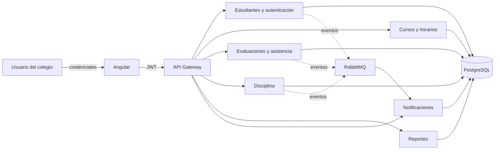
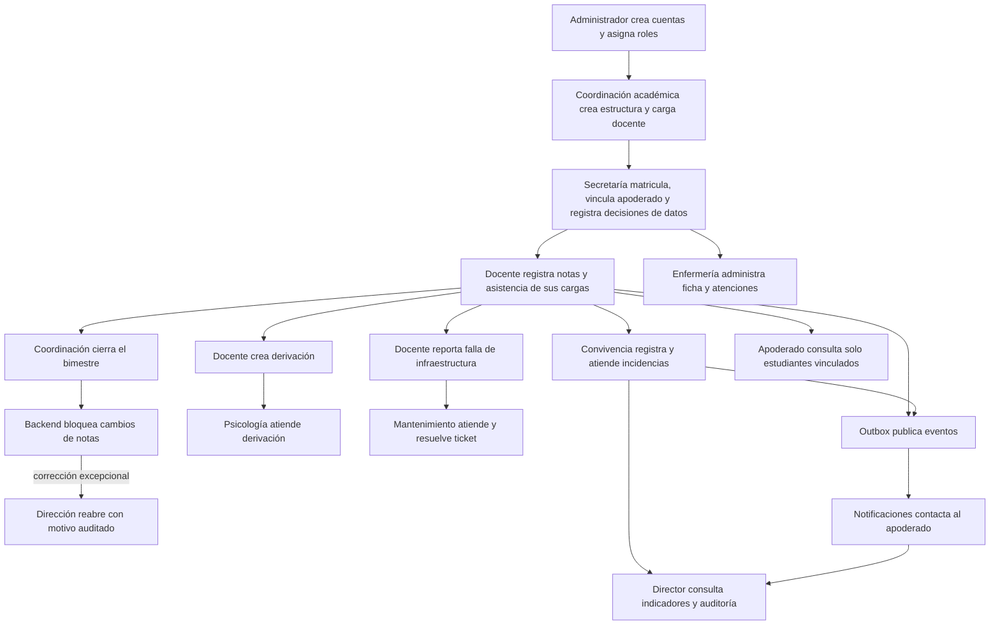

# Flujo funcional del sistema

## Vista general

El login se realiza en Estudiantes. El JWT contiene uno o varios roles. El frontend usa
esos roles para mostrar módulos y el gateway vuelve a validarlos antes de enrutar. Los
servicios sensibles repiten la autorización; ocultar un botón nunca se considera seguridad.

## Orden recomendado de operación

## Flujo diario por responsable

1. **Administrador del sistema:** da de alta al personal, asigna uno o varios roles,
   pausa cuentas y restablece claves. No opera datos académicos ni clínicos.
2. **Coordinación académica:** configura niveles, grados, secciones, cursos, docentes,
   carga académica y horarios. La carga define qué puede registrar cada docente.
3. **Secretaría:** matricula al estudiante, registra al apoderado, vincula ambos y guarda
   de forma atómica las decisiones versionadas de tratamiento de datos. También carga
   documentos; puede apoyar catálogos y horarios, pero no registrar notas.
4. **Docente:** el backend resuelve su carga y entrega únicamente sus secciones, estudiantes,
   notas, asistencias y reportes disciplinarios. Registra notas y asistencia, crea
   derivaciones y genera tickets mientras el período esté abierto.
5. **Auxiliar y convivencia:** cubren asistencia y disciplina. Convivencia también sigue
   derivaciones y comunicaciones; no ingresan notas.
6. **Psicología y Enfermería:** trabajan en módulos separados. Psicología atiende
   derivaciones; Enfermería administra fichas y atenciones médicas.
7. **Mantenimiento:** consulta tickets y aulas, cambia el ticket a En proceso y solo puede
   cerrarlo como Resuelto cuando deja notas de resolución.
8. **Apoderado:** el sistema comprueba nuevamente el vínculo antes de entregar notas,
   asistencia o documentos de cada estudiante.
9. **Coordinación académica y Director:** Coordinación cierra un bimestre con motivo; desde
   ese momento el backend rechaza altas, cambios y eliminaciones de notas. Solo Dirección
   puede reabrirlo con otro motivo, y ambos eventos quedan en un historial inmutable.
10. **Director:** supervisa indicadores, auditoría e integridad. No sustituye a los roles
   operativos en notas, asistencia, usuarios o tickets.

## Flujo de continuidad

Cada ciclo respalda las seis bases con cifrado AES-256, genera SHA-256 y restaura la copia
en una base temporal. Solo después de comparar el número de tablas escribe evidencia de
éxito. Los respaldos tienen retención automática de 30 días; una restauración productiva
requiere aprobación y nunca se hace directamente sobre la base activa.

## Flujo de notificación

La operación de negocio y el evento se guardan en la misma transacción mediante outbox.
Un publicador reintenta el evento, RabbitMQ lo entrega a Notificaciones y este servicio
registra cada intento antes de usar el proveedor configurado. En desarrollo los proveedores
pueden ser simulados; para producción deben configurarse webhooks reales y secretos seguros.

Consulta la autorización exacta en [MATRIZ_ROLES.md](MATRIZ_ROLES.md) y la forma de validar
cada recorrido en [PRUEBAS.md](PRUEBAS.md).
